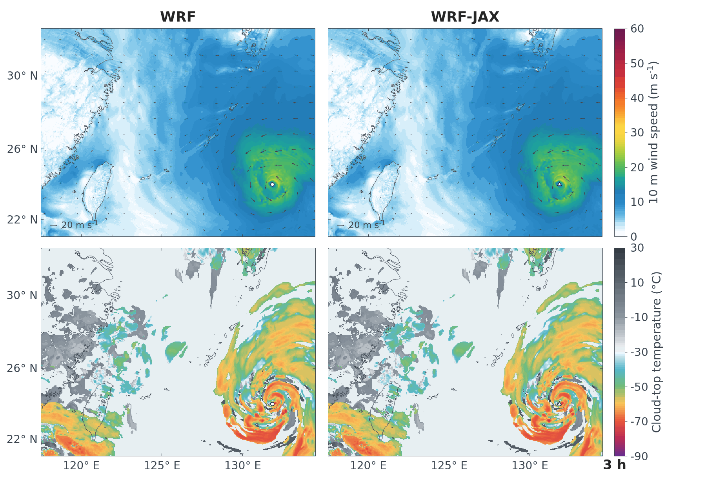

# WRF-JAX

[English](README.md) | **简体中文**

WRF 4.5 `em_real` 的 Python/JAX 实现，包含动力核心及 Thompson、Tiedtke、MYJ、Noah、RRTMG 物理方案，支持 CPU 和 NVIDIA GPU。



在项目根目录执行以下命令，按计算设备选择运行环境。

GPU 环境：

```bash
conda env create -n wrf-jax-gpu -f environment-gpu.yml
conda activate wrf-jax-gpu
export JAX_PLATFORMS=cuda
```

CPU 环境：

```bash
conda env create -n wrf-jax -f environment.yml
conda activate wrf-jax
export JAX_PLATFORMS=cpu
export XLA_FLAGS="--xla_cpu_multi_thread_eigen=true --xla_cpu_parallel_codegen_split_count=16 --xla_allow_excess_precision=false"
```

准备一个 WRF 4.5 `em_real` 单域算例目录，包含以下输入和物理参数表：

| 内容 | 文件 |
|---|---|
| 算例配置、初始场和边界场 | `namelist.input`、`wrfinput_d01`、`wrfbdy_d01` |
| 陆面参数表 | `LANDUSE.TBL`、`VEGPARM.TBL`、`SOILPARM.TBL`、`GENPARM.TBL` |
| Thompson 查表数据 | `qr_acr_qg_V4.dat`、`qr_acr_qsV2.dat`、`freezeH2O.dat`、`CCN_ACTIVATE.BIN` |
| 臭氧数据 | `ozone.formatted`、`ozone_lat.formatted`、`ozone_plev.formatted` |
| 温室气体数据（`ghg_input=1`） | `CAMtr_volume_mixing_ratio` |

辐射和地表交换的随包查表数据位于 `src/wrf_jax/physics/data/`。

下面使用当前 Conda 环境中的 Python，积分 1 小时并输出模型结果。将 `/path/to/case` 替换为算例目录。

```bash
export WRF_PY_BOOTSTRAP_PYTHON=0
export WRF_PY_COMPARE_STREAMED_SNAPSHOTS=0
export WRF_PY_KEEP_STREAMED_SNAPSHOTS=0

python main.py \
  --case-dir /path/to/case \
  --out-dir outputs/example \
  --duration-seconds 3600 \
  --snapshot-interval-seconds 3600 \
  --mode compiled-direct
```

默认配置为 `config/default_run.json`，默认运行模式为 `compiled-direct`。`--duration-seconds` 设置积分时长，`--snapshot-interval-seconds` 设置输出间隔，两者均以秒为单位，取算例时间步长的整数倍。

与原始 WRF 结果比较时，将 `WRF_PY_COMPARE_STREAMED_SNAPSHOTS` 设为 `1`，并在运行命令中添加 `--wrfout /path/to/wrfout`；参考文件包含各输出时刻的记录。

结果写入 `outputs/example/`：

- `snapshots/elapsed-*/wrfjax_uvtq_steps.nc`：各输出时刻的模型场。
- `run.log`、`run_summary.txt`：运行日志与摘要。
- `timing_summary.md`：积分耗时统计。
- 开启结果比较后，各快照目录同时输出 `comparison.md` 和 `nrmse_summary.txt`。
